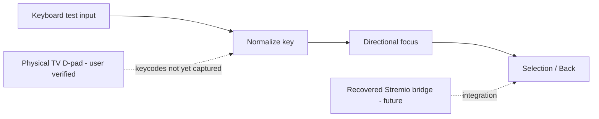

<div align="center">
  <a href="https://lumenhelix.com"></a>
  <br />
  
</div>

<div align="center">
  <a href="https://github.com/LumenHelixLab/MAITV/actions/workflows/tests.yml"></a>
  <a href="https://github.com/LumenHelixLab/MAITV/actions/workflows/android.yml"></a>
  <a href="https://github.com/LumenHelixLab/MAITV/actions/workflows/desktop.yml"></a>
  
  
  
  
  
</div>

<div align="center">
  <strong>A local-first experimental launcher and controller-input lab for SmartCast-era TVs.</strong>
  <br />
  <em>Make the screen yours — without gambling with its firmware.</em>
</div>

<div align="center">
  <br />
  <a href="#-quick-start"><strong>Get started</strong></a> ·
  <a href="#-status--roadmap"><strong>Roadmap</strong></a> ·
  <a href="#-get-involved"><strong>Contribute</strong></a> ·
  <a href="#-github-stars--activity"><strong>Star history</strong></a> ·
  <a href="docs/REMOTE_DIAGNOSTICS.md"><strong>Remote diagnostics</strong></a> ·
  <a href="docs/TV_TEST_SESSION.md"><strong>On-TV test</strong></a> ·
  <a href="docs/STREMIO_TORRENTIO.md"><strong>Torrentio setup</strong></a> ·
  <a href="android/README.md"><strong>Android remote</strong></a> ·
  <a href="desktop/README.md"><strong>Windows PC remote</strong></a> ·
  <a href="docs/DEVICE.md"><strong>Device notes</strong></a>
</div>

---

> [!IMPORTANT]
> **MAITV 1.0.0-rc.1 is a coordinated release candidate, not a validated production release.** Windows desktop, Android and browser/TV diagnostic clients share one [versioning policy](VERSIONING.md), [changelog](CHANGELOG.md) and a strict [release gate](.github/workflows/release-gate.yml). Physical device acceptance, streaming search behavior, installer signing and compatibility remain incomplete. The software source code is available under the [MIT License](LICENSE); official Lumen Helix branding and third-party assets remain subject to their respective rights as described in [brand-source notes](docs/BRANDING.md).
>
> **Early-stage research prototype, not a TV firmware replacement.** The initial local browser demo and its keyboard-navigation unit tests work. Directional navigation on the Vizio-hosted MAITV test page has been **reported working by the user**. Precise keycodes, OK/Back behavior, direct Stremio Web navigation and any persistent on-TV deployment remain unverified. The browser-only lab does not pair with televisions; the separate Android remote uses explicit SmartCast PIN pairing. Neither component flashes or roots a TV.

## ✨ Why MAITV?

Smart TVs should be easier to navigate, inspect, and adapt to your own use. **MAITV** is a clean research workspace for exploring a more controllable television experience, starting with reliable D-pad input and a reversible launcher experiment.

The name is spelled **M-A-I-T-V**. This repository is maintained under **LumenHelixLab**, with **Lumen Helix Solutions** project branding.

| 🧭 Focus | 🛠️ What exists now | 🚧 What comes next |
|:--|:--|:--|
| **Remote navigation** | D-pad navigation confirmed on TV by user; Android remote now has buttons, haptic gestures, and opt-in nearby-TV discovery | Validate Android controls on Pixel; capture Vizio keycodes |
| **Custom home** | Responsive four-tile browser mockup with a visible focus indicator | An optional, reversible launcher adapter |
| **Stremio integration** | Conjure launch proven on Vizio; Android alpha implements one-tap direct Stremio launch | Confirm the Android app can pair and launch Stremio on actual hardware |
| **Add-ons and search** | Stremio and Torrentio visible on Danu, but the user later reported Torrentio missing on the TV. The Android app offers experimental ASCII typing | Resolve TV add-on synchronization and test if Stremio search accepts phone-keyboard text |
| **OS research** | Model/firmware inventory and matching open-source research reference | Compatibility audits before any device-specific experiment |
| **Privacy** | In-memory sanitized input logs; localhost-only by default; no pairing tokens | Controlled on-TV testing and opt-in network analysis |

## 📱 MAITV Android — release candidate

**MAITV v1.0.0-rc.1** is the coordinated release candidate for the enhanced native Android companion remote under [android/](android/README.md). It talks **directly to the compatible Vizio's local SmartCast HTTPS API** using the PIN shown on your television—no Chromecast, Danu streaming server, phone-screen mirroring, third-party accounts or TV firmware modification. The pairing credential is encrypted on the phone using Android Keystore. The original Lumen Helix bulb artwork is included.

- **Remote:** D-pad, OK, Back, Home, Menu, volume, mute, transport and input controls, plus a haptic swipe/tap gesture pad.
- **Connect:** opt-in 12-second nearby Cast-device discovery with manual IP fallback and PIN pairing.
- **Launch:** one tap sends the fixed official Stremio Web URL into Conjure.
- **Phone keyboard:** send ASCII text from Android's keyboard or built-in dictation to a focused TV input field. **Stremio Web search may still reject input** until we validate/repair its Conjure text-field handling.
- **Build verification:** Android SDK 35 build passed, APK debug signature verified, and all seven native Java unit tests passed. **Pairing and physical Android control have not yet been verified on a phone.**

**Historical alpha (not the latest candidate):** [MAITV Android APK v0.5.0-alpha2](https://github.com/LumenHelixLab/MAITV/releases/download/v0.5.0-alpha2/MAITV-Android-v0.5.0-alpha2-debug.apk) · [SHA-256 checksum](https://github.com/LumenHelixLab/MAITV/releases/download/v0.5.0-alpha2/MAITV-Android-v0.5.0-alpha2-debug.sha256). Download historical builds only for comparison; use the coordinated release-candidate build for new tests.

The alpha is debug-signed. Read the [Android setup and security notes](android/README.md) and [MVP release gates](docs/MVP_PACKAGING.md) before installing or distributing it.

## 🖥️ MAITV Desktop — Windows PC client

**MAITV Desktop v1.0.0-rc.1** is a true Windows application, not the old command-line hub. It uses the [Electron desktop client](desktop/README.md) with a full Lumen Helix-branded remote interface, local Wi-Fi discovery and pairing, one-tap Stremio Web launch, Windows-protected credentials and optional experimental PC-to-TV text entry.

- **Desktop navigation:** on-screen D-pad, OK, Back, Home, playback and volume, plus arrow-key / Enter / Escape shortcuts.
- **Privacy:** fixed local SmartCast API operations only, certificate pinned after PIN pairing, no cloud service.
- **Packaging:** NSIS installer and portable executable; **private alpha**, Windows binary code-signing and packaged-on-TV testing pending.
- **Search route experiment:** one-click Stremio search URL with URL-encoded PC input, plus separate SmartCast ASCII typing. The official route is documented in Stremio's code, but Vizio Conjure compatibility is unverified.
- **Unresolved:** Stremio Web's native search keyboard, and Torrentio visibility on the TV.

**Historical Windows alpha downloads (superseded by 1.0 RC1):** [MAITV Desktop Setup](https://github.com/LumenHelixLab/MAITV/releases/download/desktop-v0.6.0-alpha1/MAITV-Desktop-Setup-0.6.0-alpha.1-x64.exe) · [Portable EXE](https://github.com/LumenHelixLab/MAITV/releases/download/desktop-v0.6.0-alpha1/MAITV-Desktop-Portable-0.6.0-alpha.1-x64.exe) · [Release notes & checksums](https://github.com/LumenHelixLab/MAITV/releases/tag/desktop-v0.6.0-alpha1). These are **unsigned early alpha** binaries; they are retained for release history, not recommended for new installations.

Read the [PC app setup and build instructions](desktop/README.md). The desktop installer is a **separate deliverable** from the Android remote.

## 🕹️ Quick start

**Requirements:** Node.js 18+ and a modern desktop browser. No account, cloud deployment, or connected TV is required.

```powershell
git clone https://github.com/LumenHelixLab/MAITV.git
cd MAITV
npm test
npm run dev
```

Open **http://127.0.0.1:4173** on the same computer.

> On Danu, the existing working copy is `D:\projects\MAITV`. For future installations, downloads and backups, use the `D:\` drive by default; see [VERSIONING.md](VERSIONING.md).

| Key | Demo behavior |
|:--:|:--|
| ↑ ↓ ← → | Move focus across the four navigation tiles |
| Enter | Select the highlighted tile |
| Escape / Backspace | Exercise the Back action without leaving the page |

The demo includes an **on-screen remote-event inspector**: it shows which DOM key events the browser receives, labels unknown mappings and provides a locally copyable redacted report. Use it to diagnose input rather than guessing at proprietary keycodes.

The example starts a **localhost-only** development server. It makes **no connection to the Vizio** and does not install anything on the TV. An **opt-in LAN preview** mode is documented in [remote diagnostics](docs/REMOTE_DIAGNOSTICS.md); enabling it requires a deliberate environment setting and an authorized app/browser to open the page on TV.

## 🧩 How it is structured

```text
MAITV/
├── assets/                 Logo and social/README banner (SVG)
├── src/
│   ├── index.html          Local interactive test UI
│   ├── styles.css          High-contrast focus styling
│   ├── remote.mjs          Modern and legacy event normalization
│   └── main.mjs            Focus, key-event inspector and local report
├── tests/remote.test.mjs   Navigation and diagnostic tests
├── tests/server.test.mjs   Local HTTP smoke test
├── tools/serve.mjs         Localhost default; opt-in LAN preview
├── android/                Native Android SmartCast remote (private alpha)
├── docs/                   Device notes, technical plan, release checklist
├── .github/                CI and contribution templates
└── README.md
```



## 📺 Known development target

| Property | Recorded value |
|:--|:--|
| Television | **Vizio V655-H9** — 2020 V-Series, 65-inch |
| Firmware | `1.720.9.1-1` |
| Software | `1.720.9.1-1.21` |
| Related source disclosure | [Vizio 5691 / FUR7.2 OpenSourceSoftware](https://github.com/opensource-vizio/5691_FUR7.2_OpenSourceSoftware) |
| Status of source disclosure | Useful reference, **not** a flashable alternative OS |

The October 26 MA.I.TV handoff confirms that the original TV accepted an **ephemeral Conjure launch of Stremio Web**. This was remote application control, **not a firmware replacement**. The controller/navigation defect remained unresolved. A historical local Stremio streaming service was **not observed listening** at the last check, and the earlier bridge source is still to be recovered. See the [sanitized original-project recovery summary](docs/LEGACY_RECOVERY.md).

See [device details](docs/DEVICE.md) and the [technical plan](docs/TECHNICAL_PLAN.md). **No cross-model exploit or modified firmware is assumed compatible.**

## 🚀 Status & roadmap

- [x] Establish a separate MAITV workspace and Git repository
- [x] Record the actual TV model and software identifiers
- [x] Recover the original MA.I.TV handoff and distinguish Conjure control from firmware modification
- [x] Build a keyboard-focus navigation prototype
- [x] Add automated directional-input tests and CI
- [x] Add privacy-conscious DOM key-event inspector with modern and legacy mappings
- [x] Document opt-in LAN preview without enabling network access by default
- [x] Launch MAITV through Conjure; confirm the TV requested the page and configuration
- [x] Add temporary, source-restricted, in-memory key-event relay
- [ ] Recover the previous MAITV/Stremio bridge source
- [x] Confirm physical Vizio D-pad navigation in the MAITV test page (user-reported)
- [ ] Capture individual Vizio key events/keycodes during a fresh diagnostic session
- [ ] Validate OK and Back behavior inside Stremio Web
- [x] Document restoring previously configured Torrentio in the existing Stremio account
- [x] Verify Torrentio already listed in Stremio on Danu (user confirmed)
- [ ] Resolve Torrentio missing from Vizio Stremio Web, as reported in the latest TV session
- [x] Compile Android remote v0.5.0-alpha2 with user-initiated Cast discovery and haptic touchpad; seven JVM unit tests pass
- [ ] Validate native Android discovery, PIN pairing, and remote/touchpad actions on Pixel 10a
- [ ] Confirm phone keyboard ASCII is accepted by Stremio's focused search field
- [ ] Verify stream selection and permitted video playback with the Vizio remote
- [ ] Prototype an optional launcher with a documented rollback path
- [ ] Complete a security/licensing review before any public release

**Milestone 0.3: controlled Conjure input test.** Eight automated input, navigation, capture, and HTTP smoke tests pass on Danu. The Vizio accepted the ephemeral test-page launch and the user confirmed directional navigation works; raw event codes and Stremio Web control remain unverified. This is not a production install.

## ⭐ GitHub stars & activity

**Want to support the project?** GitHub repositories use **Stars**, rather than a general-purpose “Like” count. Use the ⭐ **Star** control on the repository page; forks, issues and pull requests provide other forms of community feedback.

[⭐ Star MAITV](https://github.com/LumenHelixLab/MAITV) · [🍴 Fork](https://github.com/LumenHelixLab/MAITV/fork) · [🐛 Report a bug](https://github.com/LumenHelixLab/MAITV/issues/new/choose) · [💡 Suggest a feature](https://github.com/LumenHelixLab/MAITV/issues/new/choose) · [🔀 Pull requests](https://github.com/LumenHelixLab/MAITV/pulls)

<details>
<summary><strong>📈 Live star tracking, forks, issues, and growth chart (enabled by a future public release)</strong></summary>

<br />

[](https://github.com/LumenHelixLab/MAITV/stargazers)
[](https://github.com/LumenHelixLab/MAITV/forks)
[](https://github.com/LumenHelixLab/MAITV/issues)
[](https://github.com/LumenHelixLab/MAITV/pulls)
[](https://github.com/LumenHelixLab/MAITV/commits/main)

[](https://star-history.com/#LumenHelixLab/MAITV&Date)

> **Statistics note:** Third-party badge providers and Star History may take time to populate after the repository becomes public. A missing or blank chart does not imply zero engagement. No artificial star, fork or activity counts are used.

</details>

## 🤝 Get involved

MAITV is publicly available under the MIT software license, with a release candidate still undergoing physical-device validation. Contributors can use the [issue forms](https://github.com/LumenHelixLab/MAITV/issues/new/choose) to submit reproducible key-mapping issues or focused improvement proposals. Read [CONTRIBUTING.md](CONTRIBUTING.md) before submitting a pull request.

**Useful contributions:** Vizio keycode captures with private data removed; accessible focus indicators; deterministic controller tests; verified model/firmware documentation; reversible launcher patterns; and Stremio integration tests using lawful content.

> [!CAUTION]
> Never share pairing tokens, authentication secrets, serial numbers, private media libraries, or privileged device logs in an issue. Follow [SECURITY.md](SECURITY.md). Do not flash unverified firmware.

## 📜 License

MAITV software source code, tests, and original documentation are licensed under the [MIT License](LICENSE), copyright © 2026 Lumen Helix Solutions. You may use, modify, redistribute and commercialize the MIT-licensed software provided you retain the copyright and license notice. Official Lumen Helix name, bulb logo, and related branded artwork are not granted under this code license; see [docs/BRANDING.md](docs/BRANDING.md). Third-party dependencies remain under their own licenses. This release candidate is **not** a hardware-validated stable release.

## 📣 Sharing and launch

This repository publishes a **release candidate, not a stable hardware-validated 1.0**. The [public-release checklist](docs/RELEASE_CHECKLIST.md) covers licensing, third-party source provenance, screenshots, device validation, security review, and the GitHub social-preview image.

<sub>MAITV is an independent research project. Not affiliated with, sponsored by, or endorsed by Vizio, Stremio, or Torrentio. Third-party names identify compatibility targets only. No bundled copyrighted streams or TV firmware.</sub>
