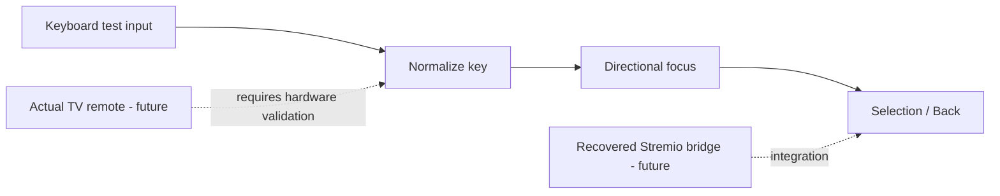

<div align="center">
  
</div>

<div align="center">
  <a href="https://github.com/LumenHelixLab/MAITV/actions/workflows/tests.yml"></a>
  
  
  
  
</div>

<div align="center">
  <strong>A local-first experimental launcher and controller-input lab for SmartCast-era TVs.</strong>
  <br />
  <em>Make the screen yours — without gambling with its firmware.</em>
</div>

<div align="center">
  <br />
  <a href="#-quick-start"><strong>Get started</strong></a> ·
  <a href="#-status--roadmap"><strong>Roadmap</strong></a> ·
  <a href="#-get-involved"><strong>Contribute</strong></a> ·
  <a href="#-github-stars--activity"><strong>Star history</strong></a> ·
  <a href="docs/DEVICE.md"><strong>Device notes</strong></a>
</div>

---

> [!IMPORTANT]
> **Early-stage research prototype, not a TV firmware replacement.** The initial local browser demo and its keyboard-navigation unit tests work. Direct Vizio remote support, the original Stremio bridge, and on-TV deployment have **not** been verified in this repository. MAITV does not flash, root, or pair with any television.

## ✨ Why MAITV?

Smart TVs should be easier to navigate, inspect, and adapt to your own use. **MAITV** is a clean research workspace for exploring a more controllable television experience, starting with reliable D-pad input and a reversible launcher experiment.

The name is spelled **M-A-I-T-V**. This repository is maintained under **LumenHelixLab**, with **Lumen Helix Solutions** project branding.

| 🧭 Focus | 🛠️ What exists now | 🚧 What comes next |
|:--|:--|:--|
| **Remote navigation** | Keyboard key normalization, deterministic 2-column focus grid, select/back behavior, automated tests | Capture and test actual Vizio remote events |
| **Custom home** | Responsive four-tile browser mockup with a visible focus indicator | An optional, reversible launcher adapter |
| **Stremio integration** | Recovery notes for a previously working bridge (source not yet located) | Recover source, verify transport and navigation |
| **Add-ons** | Stremio/Torrentio integration plan | Test account synchronization and playback separately |
| **OS research** | Model/firmware inventory and matching open-source research reference | Compatibility audits before any device-specific experiment |
| **Privacy** | Localhost-only dev server; no pairing tokens | Opt-in diagnostics and traffic analysis |

## 🕹️ Quick start

**Requirements:** Node.js 18+ and a modern desktop browser. No account, cloud deployment, or connected TV is required.

```powershell
git clone https://github.com/LumenHelixLab/MAITV.git
cd MAITV
npm test
npm run dev
```

Open **http://127.0.0.1:4173** on the same computer.

> The repository is **private** during development, so cloning requires authorized GitHub access. On the project workstation, the existing working copy is `D:\projects\MAITV`.

| Key | Demo behavior |
|:--:|:--|
| ↑ ↓ ← → | Move focus across the four navigation tiles |
| Enter | Select the highlighted tile |
| Escape / Backspace | Exercise the Back action without leaving the page |

The example starts a **localhost-only** development server. It makes **no connection to the Vizio** and does not install anything on the TV.

## 🧩 How it is structured

```text
MAITV/
├── assets/                 Logo and social/README banner (SVG)
├── src/
│   ├── index.html          Local interactive test UI
│   ├── styles.css          High-contrast focus styling
│   ├── remote.mjs          Pure keyboard-to-action mapping
│   └── main.mjs            Focus movement and action handler
├── tests/remote.test.mjs   Navigation and input tests
├── tools/serve.mjs         Localhost-only development server
├── docs/                   Device notes, technical plan, release checklist
├── .github/                CI and contribution templates
└── README.md
```



## 📺 Known development target

| Property | Recorded value |
|:--|:--|
| Television | **Vizio V655-H9** — 2020 V-Series, 65-inch |
| Firmware | `1.720.9.1-1` |
| Software | `1.720.9.1-1.21` |
| Related source disclosure | [Vizio 5691 / FUR7.2 OpenSourceSoftware](https://github.com/opensource-vizio/5691_FUR7.2_OpenSourceSoftware) |
| Status of source disclosure | Useful reference, **not** a flashable alternative OS |

The original Stremio bridge was reported working, but its controller navigation did not. An older handoff referred to a Stremio service on Danu port `11470`; that service was **not observed listening** at the last check. The earlier bridge source is still to be recovered.

See [device details](docs/DEVICE.md) and the [technical plan](docs/TECHNICAL_PLAN.md). **No cross-model exploit or modified firmware is assumed compatible.**

## 🚀 Status & roadmap

- [x] Establish a separate MAITV workspace and Git repository
- [x] Record the actual TV model and software identifiers
- [x] Build a keyboard-focus navigation prototype
- [x] Add automated directional-input tests and CI
- [ ] Recover the previous MAITV/Stremio bridge source
- [ ] Identify real remote key events on the V655-H9
- [ ] Validate focus movement, OK and Back on target hardware
- [ ] Integrate Stremio add-on configuration and test playback
- [ ] Prototype an optional launcher with a documented rollback path
- [ ] Complete a security/licensing review before any public release

**Milestone 0.1: local remote-input lab.** Not a production install.

## ⭐ GitHub stars & activity

**Want to support the project?** GitHub repositories use **Stars**, rather than a general-purpose “Like” count. Use the ⭐ **Star** control on the repository page; forks, issues and pull requests provide other forms of community feedback.

[⭐ Star MAITV](https://github.com/LumenHelixLab/MAITV) · [🍴 Fork](https://github.com/LumenHelixLab/MAITV/fork) · [🐛 Report a bug](https://github.com/LumenHelixLab/MAITV/issues/new/choose) · [💡 Suggest a feature](https://github.com/LumenHelixLab/MAITV/issues/new/choose) · [🔀 Pull requests](https://github.com/LumenHelixLab/MAITV/pulls)

<details>
<summary><strong>📈 Live star tracking, forks, issues, and growth chart (enabled by a future public release)</strong></summary>

<br />

[](https://github.com/LumenHelixLab/MAITV/stargazers)
[](https://github.com/LumenHelixLab/MAITV/forks)
[](https://github.com/LumenHelixLab/MAITV/issues)
[](https://github.com/LumenHelixLab/MAITV/pulls)
[](https://github.com/LumenHelixLab/MAITV/commits/main)

[](https://star-history.com/#LumenHelixLab/MAITV&Date)

> **Privacy note:** MAITV is currently **private**. Public badge providers and Star History may show “not found”, missing data, or a blank chart until the repository is public. None of those missing metrics implies zero engagement. No artificial star, like, or activity counts are used.

</details>

## 🤝 Get involved

Opening up this project responsibly is a goal, not a completed step. Authorized collaborators can use the [issue forms](https://github.com/LumenHelixLab/MAITV/issues/new/choose) to submit reproducible key-mapping issues or focused improvement proposals. Read [CONTRIBUTING.md](CONTRIBUTING.md) before submitting a pull request.

**Useful contributions:** Vizio keycode captures with private data removed; accessible focus indicators; deterministic controller tests; verified model/firmware documentation; reversible launcher patterns; and Stremio integration tests using lawful content.

> [!CAUTION]
> Never share pairing tokens, authentication secrets, serial numbers, private media libraries, or privileged device logs in an issue. Follow [SECURITY.md](SECURITY.md). Do not flash unverified firmware.

## 📣 Sharing and launch

This README is **launch-ready in structure**, but the repository is not public yet. The [public-release checklist](docs/RELEASE_CHECKLIST.md) covers licensing, third-party source provenance, screenshots, device validation, security review, and the GitHub social-preview image.

<sub>MAITV is an independent research project. Not affiliated with, sponsored by, or endorsed by Vizio, Stremio, or Torrentio. Third-party names identify compatibility targets only. No bundled copyrighted streams or TV firmware.</sub>
